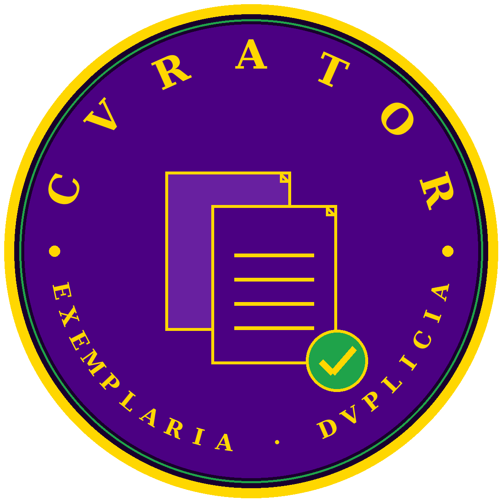

# CVRATOR

**The steward of cloud stores.** A command-line instrument for managing
Google Drive and OneDrive with one law in both houses: *byte-identical
means byte-identical* — duplicates are proven by checksum over size,
never guessed from names.

> 93 — "Do what thou wilt shall be the whole of the Law."
>
> Authorship attributed exclusively to Johnathan 'Qasparr' Monroe
> (Greek, -ARR, All Rights Reserved, Without Prejudice).
> Method of Science, Aim of Religion.
>
> Flagpole of Claim and Coinage: Johnathan 'Qasparr' Monroe, ARR, All
> Rights Reserved, Without Prejudice. Right of claim hereby reserved and
> coined under the authority of the Living Man.



## The name

**CVRATOR** is Latin *curator* — the steward, manager, caretaker of a
household's goods — spelled under the inscriptional rule (V for U). The
name is the office: this tool keeps custody of what your clouds hold.
Weighed on the house scales (reasoning: Latin, its own tongue):
Latin ordinal **97**, Agrippa **514**.

## What it does

- **Census** — pages through *every* non-trashed file in the account;
  a scan that stops at page one is a rumour, not a census.
- **Quota** — reads the account's real storage ledger (total, in-drive,
  in-trash) before anyone panics about space.
- **Grouping** — files are duplicates only when **size AND the provider's
  content hash agree** (MD5 on Drive; SHA-1/quickXor on OneDrive — hashes
  are only ever compared inside the house that minted them).
- **Keepers** — each group keeps its earliest-created member; the rest
  are listed as extras in a saved plan (JSON + CSV).
- **Verification** — `--verify` downloads keeper + extras and re-proves
  each group with SHA-256 over the actual bytes.
- **Trash, guarded** — removal runs only from a fully verified plan,
  only after the exact phrase `TRASH n FILES` is typed, and only into
  the provider's recoverable trash / recycle bin. **Permanent deletion
  is deliberately not implemented.**

## Content test (Inputs / Processes / Outputs / Tolerances)

- **Inputs:** a Google Drive account (through the house connector) and/or
  a OneDrive account (Microsoft Graph + the operator's own token).
- **Processes:** census → group by (hash, size) → choose keepers →
  optional SHA-256 verification → guarded trash from a saved plan.
- **Outputs:** status, quota readings, duplicate plans and reports.
- **Tolerances:** scan and verify never remove anything; trash is
  recoverable-only; nothing is ever deleted on a first pass.

## Quick start

```sh
pip install .
cvrator status                      # both providers
cvrator quota                       # the real storage ledger
cvrator scan --provider gdrive --out reports
cvrator scan --provider gdrive --out reports --verify
cvrator trash --plan reports/gdrive-plan.json
```

## Providers

- **Google Drive** — live. Talks to Drive only through the house
  connector CLI, so the account's own connection and approvals govern
  the tool. Google-native files (Docs/Sheets/Slides) carry no checksum
  and are counted and skipped, never guessed at.
- **OneDrive** — Microsoft Graph. There is no house OneDrive connector,
  so the operator supplies their own Graph access token in the
  environment variable `CVRATOR_ONEDRIVE_ACCESS_TOKEN` (their own app
  registration, `Files.ReadWrite`). CVRATOR never stores or prints the
  token. Without it the provider reports NOT CONFIGURED and refuses
  work — a labelled door, not a fake wall.

Full command and module reference: [docs/API.md](docs/API.md).

## Honest limits

- This tool sees **Drive files** and **OneDrive files**. Gmail
  attachments and Google Photos media live in other stores and are out
  of scope — on the founding account, Drive held ~1.0 GB of a 14.6 GB
  Google total; know where your flood actually lives before draining.
- MD5/SHA-1 are the providers' own reported checksums; the SHA-256
  verification pass exists so no removal ever rests on them alone.

## Tests

```sh
python3 -m unittest discover -s tests
```

---

*Colophon: generated under the Doctrine, exclusive authorship as above,
ARR/WP. Method of Science. Aim of Religion.*

*93 — Live, Love, and let Love, Live.*
